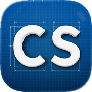
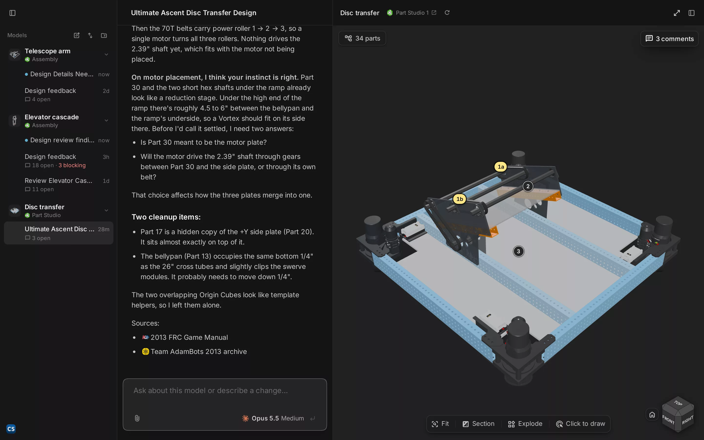

  

<h1 align="center">Cadsense</h1>

Fast CAD review for FRC teams.

  <a href="https://cadsense.johari-dev.com/download"><strong>Download</strong></a> ·
  <a href="https://cadsense.johari-dev.com">Website</a> ·
  <a href="https://github.com/johari-dev/cadsense/releases">Releases</a>

  

Cadsense finds the problems in your robot CAD before you cut anything. A belt that never meshes, a shaft with no bearing, a bolt you can't reach, a cable that pinches when the arm moves. It reviews every revision and pins each problem to the exact part.

Reviews run on the Claude Code or Codex plan you already have. Cadsense does not sell tokens or need another subscription.

## How a review goes

1. **Open your CAD.** Sync an Onshape document, or open a SolidWorks part or assembly or a STEP file.
2. **The agent works the model.** It isolates parts, cuts sections, explodes the assembly, and measures gaps, the same way you would. It posts a thumbnail of each view it checked.
3. **Comments land on parts.** Each one is rated blocker, concern, question, or nit. Click one and the camera goes there.
4. **You triage.** Resolve, discuss, or dismiss each comment. A dismiss reason becomes a rule that every later review reads, so the same false alarm does not come back.
5. **Sync the next revision.** Cadsense checks whether its earlier findings were fixed, then reviews only what changed.

Beyond review, Cadsense makes two kinds of files for the shop:

- **Part drawings.** Pick a part to get a drawing sheet with views, dimensions, and hole callouts.
- **Cut files.** Right-click a plate to export a DXF for a laser cutter or CNC router. For the router, Cadsense also plans the toolpath and plays it back on a timeline.

## Get it

Download Cadsense [here](https://cadsense.johari-dev.com/download) for macOS or Windows 10 and 11.

## License

[MIT](./LICENSE).
